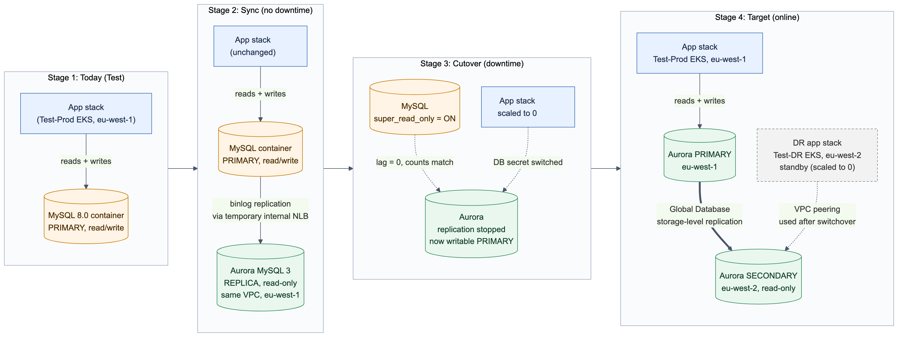
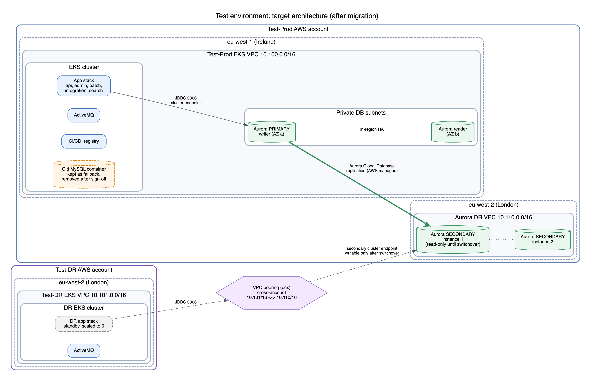
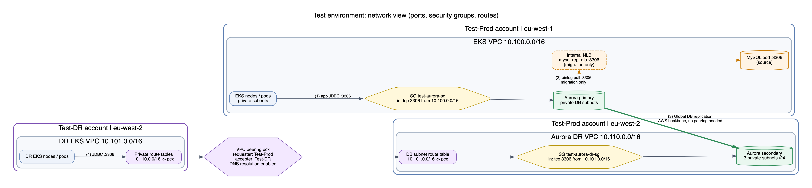
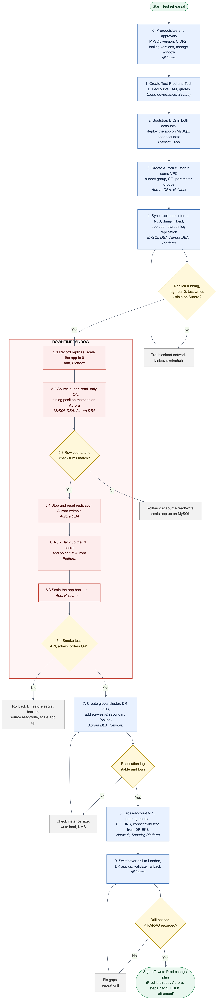

# Test Environment Runbook: MySQL to Aurora Global Database (application on Kubernetes / EKS)

This runbook rehearses, in a Test environment, the move from a MySQL database to Amazon Aurora MySQL, followed by conversion to an Aurora Global Database with a DR secondary in another region. It mirrors the production target design:

- **Primary:** Aurora cluster in eu-west-1 (Ireland), in the Test-Prod account, used by the Test-Prod EKS cluster.
- **DR secondary:** Aurora cluster in eu-west-2 (London), also in the Test-Prod account, in its own VPC.
- **DR EKS:** in the Test-DR account (eu-west-2), connected to the DR secondary over VPC peering.

> All commands are examples. Replace every `<placeholder>`, review each step, and run them one at a time. Nothing here should be pasted as one script.

Test first, then Prod. Production already runs Aurora, so once this rehearsal passes, the Prod change covers only Sections 7 to 9 plus retiring DMS.

---

## Table of contents

- [Goal](#goal)
  - [Objectives](#objectives)
  - [Success criteria](#success-criteria)
  - [In scope and out of scope](#in-scope-and-out-of-scope)
- [Timeline](#timeline)
  - [Milestones and go/no-go gates](#milestones-and-gono-go-gates)
  - [Estimated cutover window](#estimated-cutover-window)
- [Diagrams](#diagrams)
  - [Migration stages (Test)](#migration-stages-test)
  - [Target architecture (Test)](#target-architecture-test)
  - [Network view](#network-view)
  - [Process flow](#process-flow)
- [Teams and responsibilities](#teams-and-responsibilities)
- [0. Decisions and prerequisites](#0-decisions-and-prerequisites)
  - [0.1 Same region or different region?](#01-same-region-or-different-region)
  - [0.2 Do we need VPC peering?](#02-do-we-need-vpc-peering)
  - [0.3 Version compatibility (check before anything else)](#03-version-compatibility-check-before-anything-else)
  - [0.4 Tools on the operations workstation](#04-tools-on-the-operations-workstation)
  - [0.5 Variables used throughout](#05-variables-used-throughout)
- [1. Create the AWS accounts](#1-create-the-aws-accounts)
- [2. Provision the EKS clusters and a Test app stack on MySQL](#2-provision-the-eks-clusters-and-a-test-app-stack-on-mysql)
  - [2.1 Plan VPC CIDRs (must not overlap where peering is used)](#21-plan-vpc-cidrs-must-not-overlap-where-peering-is-used)
  - [2.2 Bootstrap both clusters](#22-bootstrap-both-clusters)
  - [2.3 Deploy the Test app stack on containerized MySQL (Test-Prod)](#23-deploy-the-test-app-stack-on-containerized-mysql-test-prod)
- [3. Create the Aurora cluster (primary region, Test-Prod account)](#3-create-the-aurora-cluster-primary-region-test-prod-account)
  - [3.1 Pick an engine version that supports Global Database](#31-pick-an-engine-version-that-supports-global-database)
  - [3.2 Find the EKS VPC and private subnets](#32-find-the-eks-vpc-and-private-subnets)
  - [3.3 Subnet group, security group, parameter groups](#33-subnet-group-security-group-parameter-groups)
  - [3.4 Create the cluster and writer instance](#34-create-the-cluster-and-writer-instance)
  - [3.5 A MySQL client pod in the EKS cluster](#35-a-mysql-client-pod-in-the-eks-cluster)
- [4. Make Aurora a replica of MySQL (read-only sync)](#4-make-aurora-a-replica-of-mysql-read-only-sync)
  - [4.1 Get the source database details](#41-get-the-source-database-details)
  - [4.2 Prepare the source MySQL](#42-prepare-the-source-mysql)
  - [4.3 Expose MySQL to Aurora inside the VPC](#43-expose-mysql-to-aurora-inside-the-vpc)
  - [4.4 Initial load with binlog coordinates](#44-initial-load-with-binlog-coordinates)
  - [4.5 Create the application user on Aurora](#45-create-the-application-user-on-aurora)
  - [4.6 Start replication on Aurora](#46-start-replication-on-aurora)
- [5. Cutover: stop the app, drain writes, promote Aurora](#5-cutover-stop-the-app-drain-writes-promote-aurora)
  - [5.1 Record replica counts and stop the app services](#51-record-replica-counts-and-stop-the-app-services)
  - [5.2 Confirm writes have stopped and make the source read-only](#52-confirm-writes-have-stopped-and-make-the-source-read-only)
  - [5.3 Validate the data before promoting](#53-validate-the-data-before-promoting)
  - [5.4 Stop replication and make Aurora writable](#54-stop-replication-and-make-aurora-writable)
- [6. Repoint the app stack to Aurora and validate](#6-repoint-the-app-stack-to-aurora-and-validate)
  - [6.1 Back up the current DB secret](#61-back-up-the-current-db-secret)
  - [6.2 Point the secret at Aurora](#62-point-the-secret-at-aurora)
  - [6.3 Start the app services](#63-start-the-app-services)
  - [6.4 Validate](#64-validate)
  - [6.5 Tidy up the migration pieces](#65-tidy-up-the-migration-pieces)
- [7. High availability and DR options](#7-high-availability-and-dr-options)
  - [Option A: Same region only (HA, not regional DR)](#option-a-same-region-only-ha-not-regional-dr)
  - [Option B: Cross-region Aurora Global Database (regional DR)](#option-b-cross-region-aurora-global-database-regional-dr)
- [8. VPC peering to the DR EKS](#8-vpc-peering-to-the-dr-eks)
  - [8.1 Create and accept the peering](#81-create-and-accept-the-peering)
  - [8.2 DNS resolution over the peering](#82-dns-resolution-over-the-peering)
  - [8.3 Routes on both sides](#83-routes-on-both-sides)
  - [8.4 Connectivity test from the DR EKS](#84-connectivity-test-from-the-dr-eks)
- [9. Switchover drill and failback](#9-switchover-drill-and-failback)
  - [9.1 Prepare the DR app stack (Test-DR account)](#91-prepare-the-dr-app-stack-test-dr-account)
  - [9.2 Planned switchover to London (no data loss)](#92-planned-switchover-to-london-no-data-loss)
  - [9.3 Failback to Ireland](#93-failback-to-ireland)
  - [9.4 Optional: unplanned failover test](#94-optional-unplanned-failover-test)
  - [9.5 Record for the production plan](#95-record-for-the-production-plan)
- [10. Rollback](#10-rollback)
- [11. Cleanup](#11-cleanup)
- [12. Open questions](#12-open-questions)
- [References](#references)

---

## Goal

Rehearse the full database change in a Test environment, so the production change is predictable, measured and reversible.

### Objectives

1. **Migrate** the application database from containerized MySQL to Amazon Aurora MySQL, using binlog replication so the downtime is only the final cutover.
2. **Add regional DR** by converting Aurora to an Aurora Global Database with a read-only secondary in eu-west-2.
3. **Connect the DR EKS cluster** (separate account) to the secondary over cross-account VPC peering.
4. **Prove switchover and failback** between regions, and measure downtime, replication lag and RTO.
5. **Produce a validated plan for Production**, using the timings and lessons from this rehearsal.

### Success criteria

| Criterion | Target |
|---|---|
| Data after cutover | Row counts match on every table; checksums match on key tables |
| Cutover downtime (5.1 to 6.3) | Within the agreed change window (estimate: 45 to 90 minutes) |
| App after cutover | Smoke test passes: API, admin UI, orders, search, batch jobs |
| Global Database replication lag | Normally under 1 second |
| Planned switchover | No data loss; DR app stack serves traffic in eu-west-2 |
| Failback | Writes made in eu-west-2 are visible after returning to eu-west-1 |
| RTO | Measured and recorded (target: `<agreed-RTO>`) |
| Rollback | Each rollback path in Section 10 is understood and owned |

### In scope and out of scope

| In scope | Out of scope |
|---|---|
| Test-Prod and Test-DR accounts, VPCs and EKS clusters | The Production change itself (planned after sign-off) |
| MySQL to Aurora migration with binlog replication | Application code changes |
| Aurora Global Database and cross-account VPC peering | Load and performance testing beyond the smoke test |
| Switchover drill, failback and optional failover test | Retiring DMS in Production |

---

## Timeline

An **estimate** for the Test rehearsal: about **5 weeks** (roughly 17 to 27 working days). Adjust it after Section 0, once database size, quotas and team availability are known.

| Phase | Sections | Estimated effort | Wk 1 | Wk 2 | Wk 3 | Wk 4 | Wk 5 |
|---|---|---|:-:|:-:|:-:|:-:|:-:|
| Prerequisites and approvals | 0 | 3 to 5 days | ■ | | | | |
| AWS accounts, IAM, quotas | 1 | 2 to 3 days | ■ | | | | |
| EKS clusters, app on MySQL, test data | 2 | 3 to 5 days | ■ | ■ | | | |
| Create Aurora | 3 | 1 day | | ■ | | | |
| Initial load, replication, soak (24h or more) | 4 | 2 to 3 days | | ■ | ■ | | |
| **Cutover and repoint (downtime window)** | 5, 6 | 1 day | | | ■ | | |
| Global Database and DR VPC | 7 | 1 to 2 days | | | ■ | ■ | |
| VPC peering and connectivity test | 8 | 1 day | | | | ■ | |
| Switchover drill and failback | 9 | 1 to 2 days | | | | ■ | |
| Results, sign-off, Production plan | 9.5, 12 | 2 to 3 days | | | | | ■ |

### Milestones and go/no-go gates

| Milestone | Gate to pass before moving on |
|---|---|
| End of week 1 | Accounts ready, CIDRs agreed, MySQL version confirmed (0.3) |
| End of week 2 | Replication running, lag near 0, test writes visible on Aurora (4.6) |
| Week 3, cutover day | Row counts and checksums match (5.3), then smoke test passes (6.4) |
| End of week 4 | Global replication lag stable; switchover and failback completed (9.2, 9.3) |
| End of week 5 | Downtime, lag and RTO recorded; Production plan approved |

### Estimated cutover window

| Step | Estimate |
|---|---|
| 5.1 Scale the app down | 5 to 10 min |
| 5.2 Confirm writes stopped, source read-only, positions match | 5 to 10 min |
| 5.3 Row counts and checksums | 10 to 30 min (depends on database size) |
| 5.4 Stop replication, make Aurora writable | under 5 min |
| 6.1 to 6.3 Switch the DB secret, scale the app up | 10 to 20 min |
| 6.4 Smoke test | 15 to 30 min |
| **Total downtime** | **about 45 to 90 min** |

Assumptions: the Test database is small to medium (tens of GB), quota requests are approved within a few days, and each team has someone available in the week its phases run.

---

## Diagrams

The diagram files are in the `diagrams/` folder (PNG for viewing, SVG for slides, and `.mmd` / `.dot` sources for editing).

### Migration stages (Test)

Where MySQL and Aurora sit at each stage, and which one the app uses.



### Target architecture (Test)

Aurora primary in eu-west-1 next to the Test-Prod EKS cluster, Aurora secondary in eu-west-2 in its own VPC, and the DR EKS in the Test-DR account reaching it over VPC peering.



### Network view

Ports, security groups and routes. Flows (1) and (2) are inside one VPC. Flow (3) is AWS-managed and needs no peering. Flow (4) is the only one that crosses accounts and needs peering.



### Process flow

Each phase with its owning teams, the go/no-go gates, the downtime window, and the rollback paths.



---

## Teams and responsibilities

This change needs several teams. Agree on names, a shared channel, and the change window before Section 1.

R = Responsible (does the work), A = Accountable (approves and signs off), C = Consulted, I = Informed.

| Phase | Cloud governance | Security / IAM | Network | Platform (EKS, CI/CD) | MySQL DBA | Aurora DBA | App team | QA / Test |
|---|---|---|---|---|---|---|---|---|
| 0. Prerequisites and approvals | C | C | C | R | R | R | C | I |
| 1. Accounts, IAM, quotas | R/A | R | I | C | I | I | I | I |
| 2. EKS bootstrap, app on MySQL | I | C | C | R/A | C | I | R | C |
| 3. Create Aurora | I | C | R (subnets, SG) | C | C | R/A | I | I |
| 4. MySQL to Aurora sync | I | C (repl user, secrets) | C (NLB, SG) | R (NLB, client pod) | R (binlog, dump) | R/A (load, replication) | I | I |
| 5. Cutover (downtime) | I | I | I | R (scale down) | R (read-only, positions) | R/A (validate, promote) | R (go/no-go) | C |
| 6. Repoint app and validate | I | C (secret) | I | R (DB secret, scale up) | C | C | R/A (smoke test) | R |
| 7. Global DB and DR VPC | I | C (KMS) | R (DR VPC) | I | I | R/A | I | I |
| 8. VPC peering | C | C | R/A | R (DR EKS test) | I | C | I | I |
| 9. Switchover drill and failback | I | I | C | R | I | R | R | R/A (results) |
| Sign-off and Prod plan | A | C | C | R | C | R | R | C |

What each team needs to bring:

- **Cloud governance:** AWS Organizations access to create the Test-Prod and Test-DR accounts, quota increases, cost approval for Aurora in two regions.
- **Security / IAM:** IAM users and roles for the bootstrap, review of the replication user and secrets handling, KMS key choice for eu-west-2, approval of cross-account peering.
- **Network:** non-overlapping CIDRs, DR VPC and subnets, security group rules, peering request and accept, route tables, DNS resolution over peering.
- **Platform (EKS / CI/CD):** both EKS bootstraps, the internal NLB and client pods, switching the DB secret to Aurora, scaling deployments down and up, DR app stack readiness.
- **MySQL DBA:** source version and settings, binlog configuration and retention, replication user, the consistent dump with binlog coordinates, `super_read_only` at cutover, fallback ownership.
- **Aurora DBA:** engine version and parameter groups, cluster creation, load and replication, data validation, promotion, global cluster, secondary, switchover and failback commands.
- **App team:** test data, smoke test checklist (API, admin UI, orders, search, batch jobs), go/no-go call at cutover, DR stack validation.
- **QA / Test:** independent validation after cutover and after the drill, recording downtime, lag and RTO.

Outside parties to keep in the loop:

- **AWS Support:** Aurora Global Database, binlog replication and peering questions.
- **Application vendor support (if any):** supported MySQL versions, switching the app to a new database host, and DR guidance for the app.

---

## 0. Decisions and prerequisites

### 0.1 Same region or different region?

| Step | Region | Why |
|---|---|---|
| Aurora as replica of MySQL (Sections 3 to 6) | **Same region as MySQL** (eu-west-1) | Aurora replicates from MySQL over the private network and becomes the new primary in the same place the app runs. |
| Global Database secondary (Section 7, Option B) | **Different region** (eu-west-2) | A Global Database secondary must be in a different region from the primary. It cannot be in the same region. |

If you only want protection within one region, that is Option A in Section 7: extra Aurora reader instances in other Availability Zones. That gives high availability, not regional DR.

### 0.2 Do we need VPC peering?

| Connection | Peering needed? |
|---|---|
| Aurora (primary) to MySQL during sync | **No**, if Aurora is created in the same VPC as the Test-Prod EKS cluster (this runbook does that). |
| Test-Prod EKS to Aurora primary | **No**, same VPC. |
| Aurora primary to Aurora secondary (global replication) | **No**. AWS handles this at the storage layer. |
| Test-DR EKS (DR account) to Aurora secondary (Test-Prod account, eu-west-2) | **Yes**. Different accounts and different VPCs. Peering (or Transit Gateway) is required. |

If you put the DR EKS in the same account and VPC as the Aurora secondary, you would not need peering. This runbook follows the production design, so it uses peering.

### 0.3 Version compatibility (check before anything else)

- Binlog replication only works from an **older or equal** MySQL version to a newer or equal one.
- Aurora MySQL 3 is MySQL **8.0** compatible. A source on MySQL **8.0** works.
- If the Test MySQL container is **8.4**, replicating 8.4 to Aurora MySQL 3 (8.0) is **not supported**. In that case, either check whether an 8.4-compatible Aurora MySQL version is available in your region, or use a dump and restore with a longer downtime window instead of Section 4.
- MySQL 5.7 is end of life. Do not use it for this test.
- If your deployment tooling manages the app's DB secret, confirm it can point the app at an external database host without recreating the secret (used in Section 6).

### 0.4 Tools on the operations workstation

`aws` CLI v2, `kubectl`, `jq`, your infrastructure-as-code tool (Terraform, eksctl…), a MySQL 8.0 client (optional, the runbook uses a client pod).

### 0.5 Variables used throughout

```bash
export AWS_PAGER=""
export PRIMARY_REGION=eu-west-1
export DR_REGION=eu-west-2

export TESTPROD_PROFILE=testprod      # CLI profile for the Test-Prod account
export TESTDR_PROFILE=testdr          # CLI profile for the Test-DR account
export TESTPROD_ACCT=<test-prod-account-id>
export TESTDR_ACCT=<test-dr-account-id>

export NS=<app-namespace>        # application namespace, e.g. test1
export CLUSTER_ID=test-aurora
export GLOBAL_ID=test-global
export SEC_CLUSTER_ID=test-aurora-dr
export INSTANCE_CLASS=db.r6g.large    # Global DB needs memory-optimized classes, not burstable
export MASTER_USER=dbadmin
export MASTER_PW='<strong-password>'  # or use --manage-master-user-password instead
```

---

## 1. Create the AWS accounts

Run from the AWS Organizations management account.

```bash
aws organizations create-account \
  --email test-prod@<yourdomain> --account-name "Test Prod"

aws organizations create-account \
  --email test-dr@<yourdomain> --account-name "Test DR"

# Track progress
aws organizations list-create-account-status --states IN_PROGRESS SUCCEEDED
```

Then in **each** new account:

1. Sign in via the `OrganizationAccountAccessRole` role and set up CLI profiles (`testprod`, `testdr`).
2. Create the IAM users or roles your cluster provisioning tooling needs.
3. Request a vCPU quota increase in the target region if the account is new.

---

## 2. Provision the EKS clusters and a Test app stack on MySQL

### 2.1 Plan VPC CIDRs (must not overlap where peering is used)

| VPC | Account | Region | CIDR (example) |
|---|---|---|---|
| Test-Prod EKS VPC | Test-Prod | eu-west-1 | 10.100.0.0/16 |
| Test-DR EKS VPC | Test-DR | eu-west-2 | 10.101.0.0/16 |
| Aurora secondary VPC | Test-Prod | eu-west-2 | 10.110.0.0/16 |

A VPC's primary CIDR cannot be changed after the cluster is built, so set it correctly the first time.

### 2.2 Bootstrap both clusters

In each account, create the VPC and EKS cluster with your infrastructure-as-code tool (Terraform, eksctl, CloudFormation…), using the CIDRs above.

Do not create any VPC peering here. Peering is created manually in Section 8 because it is cross-account.

### 2.3 Deploy the Test app stack on containerized MySQL (Test-Prod)

Using your CI/CD pipeline in the Test-Prod cluster:

1. Build the application images.
2. Deploy supporting services (for example the message broker, ActiveMQ) in namespace `$NS`.
3. Deploy a MySQL container running **MySQL 8.0** (see 0.3).
4. Populate the database.
5. Deploy the app stack.
6. Create some test data: a few orders and an admin change, so there is something to verify later.

For the DR account, you need the application images and supporting services available there too (build in the DR pipeline, or push images to the DR ECR). Do not deploy the DR app stack yet.

---

## 3. Create the Aurora cluster (primary region, Test-Prod account)

Aurora is created in the **same VPC and private subnets** as the Test-Prod EKS cluster, so no peering is needed for the migration.

Create it with the CLI rather than through a pipeline job that manages the cluster in Terraform. Converting a Terraform-managed cluster to a Global Database outside Terraform later would cause drift.

### 3.1 Pick an engine version that supports Global Database

```bash
aws rds describe-db-engine-versions --region $PRIMARY_REGION --profile $TESTPROD_PROFILE \
  --engine aurora-mysql \
  --query "DBEngineVersions[?SupportsGlobalDatabases].EngineVersion" --output table

export ENGINE_VERSION=<chosen-aurora-mysql-3-version>
```

Check that the same version is also available in `$DR_REGION`.

### 3.2 Find the EKS VPC and private subnets

```bash
aws ec2 describe-vpcs --region $PRIMARY_REGION --profile $TESTPROD_PROFILE \
  --filters Name=cidr,Values=10.100.0.0/16 --query "Vpcs[].VpcId" --output text
export VPC_ID=<vpc-id>

aws ec2 describe-subnets --region $PRIMARY_REGION --profile $TESTPROD_PROFILE \
  --filters Name=vpc-id,Values=$VPC_ID \
  --query "Subnets[].{Id:SubnetId,AZ:AvailabilityZone,Cidr:CidrBlock,Public:MapPublicIpOnLaunch,Name:Tags[?Key=='Name']|[0].Value}" \
  --output table
# Choose the PRIVATE subnets (Public = False), ideally one per AZ
```

### 3.3 Subnet group, security group, parameter groups

```bash
aws rds create-db-subnet-group --region $PRIMARY_REGION --profile $TESTPROD_PROFILE \
  --db-subnet-group-name test-aurora-subnets \
  --db-subnet-group-description "Test Aurora" \
  --subnet-ids <private-subnet-a> <private-subnet-b> <private-subnet-c>

export AURORA_SG=$(aws ec2 create-security-group --region $PRIMARY_REGION --profile $TESTPROD_PROFILE \
  --group-name test-aurora-sg --description "Test Aurora" --vpc-id $VPC_ID \
  --query GroupId --output text)

# Allow MySQL from inside the EKS VPC (pods and nodes)
aws ec2 authorize-security-group-ingress --region $PRIMARY_REGION --profile $TESTPROD_PROFILE \
  --group-id $AURORA_SG --protocol tcp --port 3306 --cidr 10.100.0.0/16
```

Check the source MySQL settings first, so Aurora matches them:

```sql
SELECT @@version, @@character_set_server, @@collation_server,
       @@lower_case_table_names, @@transaction_isolation, @@sql_mode,
       @@log_bin, @@binlog_format, @@server_id;
```

```bash
aws rds create-db-cluster-parameter-group --region $PRIMARY_REGION --profile $TESTPROD_PROFILE \
  --db-cluster-parameter-group-name test-aurora-cpg \
  --db-parameter-group-family aurora-mysql8.0 \
  --description "Test Aurora cluster params"

aws rds modify-db-cluster-parameter-group --region $PRIMARY_REGION --profile $TESTPROD_PROFILE \
  --db-cluster-parameter-group-name test-aurora-cpg \
  --parameters \
  "ParameterName=character_set_server,ParameterValue=utf8mb4,ApplyMethod=pending-reboot" \
  "ParameterName=collation_server,ParameterValue=<match-source>,ApplyMethod=pending-reboot" \
  "ParameterName=transaction_isolation,ParameterValue=READ-COMMITTED,ApplyMethod=pending-reboot" \
  "ParameterName=lower_case_table_names,ParameterValue=<match-source>,ApplyMethod=pending-reboot"
```

`lower_case_table_names` can only be set when the cluster is created. Get it right now.

**Read-only during sync (optional):** check whether `read_only` is modifiable in your cluster parameter group:

```bash
aws rds describe-db-cluster-parameters --region $PRIMARY_REGION --profile $TESTPROD_PROFILE \
  --db-cluster-parameter-group-name test-aurora-cpg \
  --query "Parameters[?ParameterName=='read_only']"
```

If it is, set it to `1` now and back to `0` at cutover. Replication still applies changes while `read_only` is on. In any case, the main protection is that the app has no credentials for Aurora until cutover.

### 3.4 Create the cluster and writer instance

```bash
aws rds create-db-cluster --region $PRIMARY_REGION --profile $TESTPROD_PROFILE \
  --db-cluster-identifier $CLUSTER_ID \
  --engine aurora-mysql --engine-version $ENGINE_VERSION \
  --master-username $MASTER_USER --master-user-password "$MASTER_PW" \
  --db-subnet-group-name test-aurora-subnets \
  --vpc-security-group-ids $AURORA_SG \
  --db-cluster-parameter-group-name test-aurora-cpg \
  --storage-encrypted \
  --backup-retention-period 7

aws rds create-db-instance --region $PRIMARY_REGION --profile $TESTPROD_PROFILE \
  --db-instance-identifier ${CLUSTER_ID}-1 \
  --db-cluster-identifier $CLUSTER_ID \
  --db-instance-class $INSTANCE_CLASS --engine aurora-mysql

aws rds wait db-instance-available --region $PRIMARY_REGION --profile $TESTPROD_PROFILE \
  --db-instance-identifier ${CLUSTER_ID}-1

export AURORA_EP=$(aws rds describe-db-clusters --region $PRIMARY_REGION --profile $TESTPROD_PROFILE \
  --db-cluster-identifier $CLUSTER_ID --query "DBClusters[0].Endpoint" --output text)
echo $AURORA_EP
```

### 3.5 A MySQL client pod in the EKS cluster

Aurora is private, so run client commands from inside the cluster:

```bash
kubectl -n $NS run mysql-client --image=mysql:8.0 --restart=Never -- sleep infinity
kubectl -n $NS wait --for=condition=Ready pod/mysql-client

kubectl -n $NS exec -it mysql-client -- mysql -h $AURORA_EP -u $MASTER_USER -p -e "SELECT @@version;"
```

---

## 4. Make Aurora a replica of MySQL (read-only sync)

In this phase MySQL is still the live primary. Aurora follows it through binlog replication and nothing writes to Aurora except the replication thread.

### 4.1 Get the source database details

The app's DB secret in `$NS` holds the database host, name, user and password.

```bash
kubectl -n $NS get secrets
kubectl -n $NS get secret <db-secret-name> -o json | jq '.data | map_values(@base64d)'

kubectl -n $NS get pods -l <mysql-pod-label> -o wide   # or: kubectl -n $NS get pods | grep mysql
export MYSQL_POD=<mysql-pod-name>
export APP_DB=<database-name>
```

### 4.2 Prepare the source MySQL

```bash
kubectl -n $NS exec -it $MYSQL_POD -- mysql -uroot -p
```

```sql
-- Binlog must be ON and ROW (default in MySQL 8.0)
SHOW VARIABLES WHERE Variable_name IN ('log_bin','binlog_format','server_id','binlog_expire_logs_seconds');

-- Replication user. mysql_native_password avoids TLS requirements of caching_sha2_password
CREATE USER 'repl'@'%' IDENTIFIED WITH mysql_native_password BY '<repl-password>';
GRANT REPLICATION SLAVE, REPLICATION CLIENT ON *.* TO 'repl'@'%';
```

Make sure binlog retention (`binlog_expire_logs_seconds`) covers the time between the dump and the start of replication, with plenty of margin.

### 4.3 Expose MySQL to Aurora inside the VPC

The containerized MySQL Service is `ClusterIP`, which Aurora cannot reach. Add an **internal** NLB Service for the test:

```yaml
# mysql-repl-nlb.yaml
apiVersion: v1
kind: Service
metadata:
  name: mysql-repl-nlb
  namespace: <app-namespace>
  annotations:
    service.beta.kubernetes.io/aws-load-balancer-type: "nlb"
    service.beta.kubernetes.io/aws-load-balancer-internal: "true"
spec:
  type: LoadBalancer
  selector:
    <same-labels-as-the-mysql-pod>
  ports:
    - port: 3306
      targetPort: 3306
```

```bash
kubectl apply -f mysql-repl-nlb.yaml
kubectl -n $NS get svc mysql-repl-nlb    # wait for EXTERNAL-IP (an internal NLB DNS name)
export MYSQL_NLB=<nlb-dns-name>

kubectl -n $NS get networkpolicy        # if policies exist, allow 3306 from the VPC CIDR
```

The EKS node security group must allow TCP 3306 (and the NodePort range if the NLB uses instance targets) from the VPC CIDR. Test from the client pod:

```bash
kubectl -n $NS exec -it mysql-client -- mysql -h $MYSQL_NLB -u repl -p -e "SELECT 1;"
```

### 4.4 Initial load with binlog coordinates

```bash
# MySQL 8.0.26+ uses --source-data; older 8.0 uses --master-data
kubectl -n $NS exec $MYSQL_POD -- sh -c \
 'mysqldump -uroot -p"$MYSQL_ROOT_PASSWORD" --single-transaction --source-data=2 \
  --routines --triggers --events --set-gtid-purged=OFF --databases '"$APP_DB" \
  > app_dump.sql

# Binlog file and position recorded in the dump
grep -m1 -E "CHANGE (REPLICATION SOURCE|MASTER) TO" app_dump.sql
# e.g. -- CHANGE REPLICATION SOURCE TO SOURCE_LOG_FILE='binlog.000012', SOURCE_LOG_POS=1543;
export BINLOG_FILE=<file>
export BINLOG_POS=<pos>

# Load into Aurora
kubectl -n $NS exec -i mysql-client -- mysql -h $AURORA_EP -u $MASTER_USER -p"$MASTER_PW" < app_dump.sql
```

The root password environment variable inside the MySQL container may have a different name. Use the admin credentials from the DB secret if needed. For large databases, consider `mydumper`/`myloader` for a faster load.

### 4.5 Create the application user on Aurora

A single-database dump does not include users. Create the same user and password the app uses (from the DB secret), so the secret change at cutover is only the host:

```sql
CREATE USER '<app-user>'@'%' IDENTIFIED BY '<app-password>';
GRANT ALL PRIVILEGES ON `<database-name>`.* TO '<app-user>'@'%';
```

### 4.6 Start replication on Aurora

Connect to Aurora as `$MASTER_USER`:

```sql
CALL mysql.rds_set_external_source(
  '<MYSQL_NLB>', 3306, 'repl', '<repl-password>',
  '<BINLOG_FILE>', <BINLOG_POS>, 0);
-- On older Aurora MySQL 3 versions use mysql.rds_set_external_master with the same arguments

CALL mysql.rds_start_replication;

SHOW REPLICA STATUS\G
-- Expect: Replica_IO_Running = Yes, Replica_SQL_Running = Yes, Seconds_Behind_Source falling to 0
```

Leave it running and confirm that test writes in the app (a new order, an admin edit) appear on Aurora within seconds.

---

## 5. Cutover: stop the app, drain writes, promote Aurora

**Downtime starts at 5.1.**

### 5.1 Record replica counts and stop the app services

```bash
kubectl -n $NS get deploy -o custom-columns=NAME:.metadata.name,REPLICAS:.spec.replicas --no-headers \
  | tee replicas-before.txt

# Scale everything except MySQL and ActiveMQ to zero
grep -v -E "mysql|activemq" replicas-before.txt | awk '{print $1}' \
  | xargs -I{} kubectl -n $NS scale deploy {} --replicas=0

kubectl -n $NS get pods    # wait until only mysql, activemq and mysql-client remain
```

### 5.2 Confirm writes have stopped and make the source read-only

On the **source** MySQL:

```sql
SHOW PROCESSLIST;                 -- no app connections left
SET GLOBAL super_read_only = ON;  -- blocks any stray writes; keeps the source as a clean fallback
SHOW MASTER STATUS;               -- on 8.4: SHOW BINARY LOG STATUS. Note File and Position
```

On **Aurora**:

```sql
SHOW REPLICA STATUS\G
-- Relay_Source_Log_File and Exec_Source_Log_Pos must equal the source File and Position
-- Seconds_Behind_Source = 0
```

### 5.3 Validate the data before promoting

Generate exact row counts for every table, run on both sides, and compare:

```bash
cat > counts.sql <<'EOF'
SELECT CONCAT('SELECT ''', table_name, ''' t, COUNT(*) c FROM `', table_schema, '`.`', table_name, '` UNION ALL')
FROM information_schema.tables
WHERE table_schema = DATABASE() AND table_type = 'BASE TABLE';
EOF
```

Build the UNION query from that output (drop the final `UNION ALL`), run it against the source and Aurora into `src.txt` and `aurora.txt`, then:

```bash
diff src.txt aurora.txt && echo "Row counts match"
```

Spot-check a few key tables with `CHECKSUM TABLE <table>;` on both sides.

### 5.4 Stop replication and make Aurora writable

```sql
CALL mysql.rds_stop_replication;
CALL mysql.rds_reset_external_source;   -- or mysql.rds_reset_external_master
```

If you set `read_only=1` in 3.3, set it back to `0` in the cluster parameter group now and confirm with `SELECT @@read_only;`.

Aurora is now the primary database.

---

## 6. Repoint the app stack to Aurora and validate

### 6.1 Back up the current DB secret

```bash
kubectl -n $NS get secret <db-secret-name> -o yaml > db-secret-mysql-backup.yaml
```

### 6.2 Point the secret at Aurora

Change only the host in the DB secret to the Aurora cluster endpoint (`$AURORA_EP`). The port, database name, app user and password stay the same (4.5). Use your pipeline's database-switch job if you have one, or patch the secret directly:

```bash
kubectl -n $NS patch secret <db-secret-name> --type merge \
  -p "{\"stringData\":{\"<host-key>\":\"$AURORA_EP\"}}"
```

Verify:

```bash
kubectl -n $NS get secret <db-secret-name> -o json | jq '.data | map_values(@base64d)'
# Host must now be the Aurora cluster endpoint
```

### 6.3 Start the app services

```bash
awk '{print $1, $2}' replicas-before.txt | grep -v -E "mysql|activemq" \
  | while read d r; do kubectl -n $NS scale deploy "$d" --replicas="$r"; done

kubectl -n $NS get pods -w
```

**Downtime ends when the services are healthy.**

### 6.4 Validate

- All pods Running and Ready, no DB errors in logs: `kubectl -n $NS logs deploy/<api-deployment> | grep -i -E "sql|jdbc|exception"`
- The API responds and the admin UI login works.
- The test orders from Section 2 are present.
- Place a new order and make an admin change, then confirm both on Aurora:
  `kubectl -n $NS exec -it mysql-client -- mysql -h $AURORA_EP -u <app-user> -p <db> -e "SELECT ..."`
- Confirm the app is **not** connecting to the old MySQL: `SHOW PROCESSLIST;` on the source should show no app sessions.

### 6.5 Tidy up the migration pieces

```bash
kubectl -n $NS delete svc mysql-repl-nlb
```

On the old MySQL: `DROP USER 'repl'@'%';`. Keep the old MySQL container itself for a few days as a fallback (Section 10).

---

## 7. High availability and DR options

### Option A: Same region only (HA, not regional DR)

Add a reader in another AZ. If the writer fails, Aurora promotes the reader automatically.

```bash
aws rds create-db-instance --region $PRIMARY_REGION --profile $TESTPROD_PROFILE \
  --db-instance-identifier ${CLUSTER_ID}-2 \
  --db-cluster-identifier $CLUSTER_ID \
  --db-instance-class $INSTANCE_CLASS --engine aurora-mysql \
  --availability-zone ${PRIMARY_REGION}b
```

Test it:

```bash
aws rds failover-db-cluster --region $PRIMARY_REGION --profile $TESTPROD_PROFILE \
  --db-cluster-identifier $CLUSTER_ID
```

The app keeps using the cluster endpoint, which follows the new writer. Do this whether or not you also do Option B.

### Option B: Cross-region Aurora Global Database (regional DR)

This is online. The primary keeps serving the app throughout.

#### B.1 Convert the cluster to a global cluster

Requirements: replication from MySQL is stopped and reset (Section 5.4), and the engine version supports Global Database (3.1).

```bash
aws rds create-global-cluster --region $PRIMARY_REGION --profile $TESTPROD_PROFILE \
  --global-cluster-identifier $GLOBAL_ID \
  --source-db-cluster-identifier arn:aws:rds:$PRIMARY_REGION:$TESTPROD_ACCT:cluster:$CLUSTER_ID

aws rds describe-global-clusters --region $PRIMARY_REGION --profile $TESTPROD_PROFILE \
  --global-cluster-identifier $GLOBAL_ID --query "GlobalClusters[0].Status"
```

#### B.2 Create the secondary VPC (Test-Prod account, eu-west-2)

```bash
export SEC_VPC_ID=$(aws ec2 create-vpc --region $DR_REGION --profile $TESTPROD_PROFILE \
  --cidr-block 10.110.0.0/16 \
  --tag-specifications 'ResourceType=vpc,Tags=[{Key=Name,Value=test-aurora-dr-vpc}]' \
  --query Vpc.VpcId --output text)

for az in a b c; do
  idx=$(( $(printf '%d' "'$az") - 96 ))
  aws ec2 create-subnet --region $DR_REGION --profile $TESTPROD_PROFILE \
    --vpc-id $SEC_VPC_ID --availability-zone ${DR_REGION}$az \
    --cidr-block 10.110.$idx.0/24 \
    --tag-specifications "ResourceType=subnet,Tags=[{Key=Name,Value=test-aurora-dr-$az}]"
done

aws ec2 describe-subnets --region $DR_REGION --profile $TESTPROD_PROFILE \
  --filters Name=vpc-id,Values=$SEC_VPC_ID --query "Subnets[].SubnetId" --output text

aws rds create-db-subnet-group --region $DR_REGION --profile $TESTPROD_PROFILE \
  --db-subnet-group-name test-aurora-dr-subnets \
  --db-subnet-group-description "Test Aurora DR" \
  --subnet-ids <subnet-a> <subnet-b> <subnet-c>

export SEC_SG=$(aws ec2 create-security-group --region $DR_REGION --profile $TESTPROD_PROFILE \
  --group-name test-aurora-dr-sg --description "Test Aurora DR" --vpc-id $SEC_VPC_ID \
  --query GroupId --output text)

# Allow MySQL from the Test-DR EKS VPC (over peering, Section 8)
aws ec2 authorize-security-group-ingress --region $DR_REGION --profile $TESTPROD_PROFILE \
  --group-id $SEC_SG --protocol tcp --port 3306 --cidr 10.101.0.0/16
```

Recreate the cluster parameter group in eu-west-2 with the same values as `test-aurora-cpg` (Section 3.3), named `test-aurora-cpg` as well.

#### B.3 Add the secondary cluster

No master username or password. They come from the primary.

```bash
aws rds create-db-cluster --region $DR_REGION --profile $TESTPROD_PROFILE \
  --db-cluster-identifier $SEC_CLUSTER_ID \
  --global-cluster-identifier $GLOBAL_ID \
  --engine aurora-mysql --engine-version $ENGINE_VERSION \
  --db-subnet-group-name test-aurora-dr-subnets \
  --vpc-security-group-ids $SEC_SG \
  --db-cluster-parameter-group-name test-aurora-cpg \
  --kms-key-id alias/aws/rds          # primary is encrypted; use a CMK ARN in eu-west-2 if you prefer

aws rds create-db-instance --region $DR_REGION --profile $TESTPROD_PROFILE \
  --db-instance-identifier ${SEC_CLUSTER_ID}-1 \
  --db-cluster-identifier $SEC_CLUSTER_ID \
  --db-instance-class $INSTANCE_CLASS --engine aurora-mysql

aws rds wait db-instance-available --region $DR_REGION --profile $TESTPROD_PROFILE \
  --db-instance-identifier ${SEC_CLUSTER_ID}-1
```

Add a second instance (`${SEC_CLUSTER_ID}-2`, another AZ) so the DR side has in-region failover after promotion.

#### B.4 Check replication

```bash
aws cloudwatch get-metric-statistics --region $DR_REGION --profile $TESTPROD_PROFILE \
  --namespace AWS/RDS --metric-name AuroraGlobalDBReplicationLag \
  --dimensions Name=DBClusterIdentifier,Value=$SEC_CLUSTER_ID \
  --start-time $(date -u -d '-30 min' +%FT%TZ) --end-time $(date -u +%FT%TZ) \
  --period 60 --statistics Average Maximum

export SEC_WRITER_EP=$(aws rds describe-db-clusters --region $DR_REGION --profile $TESTPROD_PROFILE \
  --db-cluster-identifier $SEC_CLUSTER_ID --query "DBClusters[0].Endpoint" --output text)
export SEC_READER_EP=$(aws rds describe-db-clusters --region $DR_REGION --profile $TESTPROD_PROFILE \
  --db-cluster-identifier $SEC_CLUSTER_ID --query "DBClusters[0].ReaderEndpoint" --output text)
```

Lag is reported in milliseconds and should normally be well under a second.

The secondary is **read-only** until a switchover or failover. Any app that tries to write to it will fail.

---

## 8. VPC peering to the DR EKS

Needed because the DR EKS (Test-DR account) and the Aurora secondary (Test-Prod account) are in different accounts and VPCs.

### 8.1 Create and accept the peering

```bash
export DR_VPC_ID=$(aws ec2 describe-vpcs --region $DR_REGION --profile $TESTDR_PROFILE \
  --filters Name=cidr,Values=10.101.0.0/16 --query "Vpcs[0].VpcId" --output text)

# Test-Prod account requests
export PCX_ID=$(aws ec2 create-vpc-peering-connection --region $DR_REGION --profile $TESTPROD_PROFILE \
  --vpc-id $SEC_VPC_ID --peer-vpc-id $DR_VPC_ID --peer-owner-id $TESTDR_ACCT \
  --query VpcPeeringConnection.VpcPeeringConnectionId --output text)

# Test-DR account accepts
aws ec2 accept-vpc-peering-connection --region $DR_REGION --profile $TESTDR_PROFILE \
  --vpc-peering-connection-id $PCX_ID
```

### 8.2 DNS resolution over the peering

```bash
aws ec2 modify-vpc-peering-connection-options --region $DR_REGION --profile $TESTPROD_PROFILE \
  --vpc-peering-connection-id $PCX_ID \
  --requester-peering-connection-options AllowDnsResolutionFromRemoteVpc=true

aws ec2 modify-vpc-peering-connection-options --region $DR_REGION --profile $TESTDR_PROFILE \
  --vpc-peering-connection-id $PCX_ID \
  --accepter-peering-connection-options AllowDnsResolutionFromRemoteVpc=true
```

### 8.3 Routes on both sides

```bash
# Test-Prod side: route table(s) used by the Aurora DR subnets
aws ec2 describe-route-tables --region $DR_REGION --profile $TESTPROD_PROFILE \
  --filters Name=vpc-id,Values=$SEC_VPC_ID --query "RouteTables[].RouteTableId" --output text

aws ec2 create-route --region $DR_REGION --profile $TESTPROD_PROFILE \
  --route-table-id <aurora-dr-rtb> \
  --destination-cidr-block 10.101.0.0/16 --vpc-peering-connection-id $PCX_ID

# Test-DR side: every route table used by the EKS node (private) subnets
aws ec2 describe-route-tables --region $DR_REGION --profile $TESTDR_PROFILE \
  --filters Name=vpc-id,Values=$DR_VPC_ID \
  --query "RouteTables[].{Id:RouteTableId,Subnets:Associations[].SubnetId}" --output json

aws ec2 create-route --region $DR_REGION --profile $TESTDR_PROFILE \
  --route-table-id <dr-eks-private-rtb> \
  --destination-cidr-block 10.110.0.0/16 --vpc-peering-connection-id $PCX_ID
```

The security group rule on the Aurora secondary was added in B.2. If the DR EKS node security group restricts egress, allow TCP 3306 to 10.110.0.0/16.

### 8.4 Connectivity test from the DR EKS

```bash
# kubectl context: Test-DR cluster
kubectl create ns dbtest
kubectl -n dbtest run mysql-client --image=mysql:8.0 --restart=Never -- sleep infinity
kubectl -n dbtest wait --for=condition=Ready pod/mysql-client

kubectl -n dbtest exec -it mysql-client -- getent hosts $SEC_READER_EP     # resolves to 10.110.x.x
kubectl -n dbtest exec -it mysql-client -- \
  mysql -h $SEC_READER_EP -u <app-user> -p <db> -e "SELECT COUNT(*) FROM <a-key-table>;"
```

The count should match the primary.

---

## 9. Switchover drill and failback

The DR app stack in the Test-DR account must point at the secondary **cluster (writer) endpoint**, `$SEC_WRITER_EP`. That endpoint only accepts writes after the secondary is promoted, so keep the DR stack scaled to zero until the drill.

### 9.1 Prepare the DR app stack (Test-DR account)

1. ActiveMQ deployed in the DR namespace, application images available in the DR account.
2. Create the DR app's DB secret with host `$SEC_WRITER_EP`, port 3306, the database name, and the **same app user and password as primary** (users replicate from the primary).
3. Do not run data population against it (the secondary is read-only and already has the data).
4. Deploy the app stack, then scale all its deployments to zero and record the replica counts as in 5.1.

### 9.2 Planned switchover to London (no data loss)

Record start and end times for each step. This gives you the measured RTO.

```bash
# 1. Stop writes in Ireland (Test-Prod EKS), as in 5.1
# 2. Switch over
aws rds switchover-global-cluster --region $PRIMARY_REGION --profile $TESTPROD_PROFILE \
  --global-cluster-identifier $GLOBAL_ID \
  --target-db-cluster-identifier arn:aws:rds:$DR_REGION:$TESTPROD_ACCT:cluster:$SEC_CLUSTER_ID

# 3. Wait until London is the writer
aws rds describe-global-clusters --region $PRIMARY_REGION --profile $TESTPROD_PROFILE \
  --global-cluster-identifier $GLOBAL_ID \
  --query "GlobalClusters[0].{Status:Status,Members:GlobalClusterMembers[].{Arn:DBClusterArn,Writer:IsWriter}}"

# 4. Scale up the DR app stack (Test-DR EKS) from its recorded replica counts
```

Validate in London: pods healthy, the API and admin UI work, place an order and make an admin change.

### 9.3 Failback to Ireland

```bash
# 1. Scale the DR app stack back to zero
# 2. Switch back
aws rds switchover-global-cluster --region $DR_REGION --profile $TESTPROD_PROFILE \
  --global-cluster-identifier $GLOBAL_ID \
  --target-db-cluster-identifier arn:aws:rds:$PRIMARY_REGION:$TESTPROD_ACCT:cluster:$CLUSTER_ID
# 3. Wait for Ireland to be writer, then scale the Test-Prod app stack back up
```

Confirm the order and admin change made in London are visible in Ireland.

### 9.4 Optional: unplanned failover test

Simulates a regional outage. It can lose the most recent writes, so only do this in Test:

```bash
aws rds failover-global-cluster --region $DR_REGION --profile $TESTPROD_PROFILE \
  --global-cluster-identifier $GLOBAL_ID \
  --target-db-cluster-identifier arn:aws:rds:$DR_REGION:$TESTPROD_ACCT:cluster:$SEC_CLUSTER_ID \
  --allow-data-loss
```

After a failover, check the global cluster membership. Rebuild the old primary as a secondary if it did not rejoin automatically.

### 9.5 Record for the production plan

- Cutover downtime (5.1 to 6.3)
- Replication lag under load
- Switchover time and DR stack startup time (RTO)
- Any manual steps that surprised you

---

## 10. Rollback

| When | How |
|---|---|
| Before 5.1 (sync running) | `CALL mysql.rds_stop_replication;` on Aurora and delete the Aurora cluster. The app was never affected. |
| During 5.x (app stopped, secret unchanged) | On the source: `SET GLOBAL super_read_only = OFF;`. Scale the app back up. |
| After 6.x (app on Aurora) | Scale the app to zero. `kubectl apply -f db-secret-mysql-backup.yaml`. On the source: `SET GLOBAL super_read_only = OFF;`. Scale the app up. Writes made on Aurora after cutover are not on MySQL, which is acceptable in Test. |
| After 7 (global) | `aws rds remove-from-global-cluster` detaches the secondary without affecting the primary. |

Keep the old MySQL container untouched until the drill in Section 9 has passed.

---

## 11. Cleanup

Aurora `r` class instances in two regions cost money every hour. Remove the test when finished:

```bash
# Detach and delete the secondary
aws rds remove-from-global-cluster --region $DR_REGION --profile $TESTPROD_PROFILE \
  --global-cluster-identifier $GLOBAL_ID \
  --db-cluster-identifier arn:aws:rds:$DR_REGION:$TESTPROD_ACCT:cluster:$SEC_CLUSTER_ID
aws rds delete-db-instance --region $DR_REGION --profile $TESTPROD_PROFILE --db-instance-identifier ${SEC_CLUSTER_ID}-1
aws rds delete-db-cluster --region $DR_REGION --profile $TESTPROD_PROFILE \
  --db-cluster-identifier $SEC_CLUSTER_ID --skip-final-snapshot

# Remove the primary from the global cluster, then delete the global cluster
aws rds remove-from-global-cluster --region $PRIMARY_REGION --profile $TESTPROD_PROFILE \
  --global-cluster-identifier $GLOBAL_ID \
  --db-cluster-identifier arn:aws:rds:$PRIMARY_REGION:$TESTPROD_ACCT:cluster:$CLUSTER_ID
aws rds delete-global-cluster --region $PRIMARY_REGION --profile $TESTPROD_PROFILE \
  --global-cluster-identifier $GLOBAL_ID

# Primary cluster (take a final snapshot if you want to keep the data)
aws rds delete-db-instance --region $PRIMARY_REGION --profile $TESTPROD_PROFILE --db-instance-identifier ${CLUSTER_ID}-1
aws rds delete-db-cluster --region $PRIMARY_REGION --profile $TESTPROD_PROFILE \
  --db-cluster-identifier $CLUSTER_ID --final-db-snapshot-identifier ${CLUSTER_ID}-final

# Network
aws ec2 delete-vpc-peering-connection --region $DR_REGION --profile $TESTPROD_PROFILE --vpc-peering-connection-id $PCX_ID
# then delete the DR subnet group, security group, subnets and VPC in eu-west-2
```

Tear down the EKS clusters with your infrastructure-as-code tool, then close the test accounts if no longer needed.

---

## 12. Open questions

1. **Source MySQL version** in Test: 8.0 or 8.4? An 8.4 source cannot replicate into Aurora MySQL 3 (Section 0.3).
2. **Source type**: containerized MySQL (assumed here) or RDS for MySQL? For RDS for MySQL, replace Section 4 with an Aurora read replica (`aws rds create-db-cluster ... --replication-source-identifier <rds-mysql-arn>`) and replace 5.4 with `aws rds promote-read-replica-db-cluster`.
3. **Database size**: decides whether `mysqldump` is fast enough for the initial load.
4. **Deployment tooling**: can it point the app at an external database host, or must the DB secret be patched by hand?
5. **DR account readiness**: are application images and ActiveMQ available in the Test-DR account for the drill?

## References

- AWS documentation: Aurora Global Database, and replication between Aurora and MySQL or another Aurora cluster (binlog replication)
