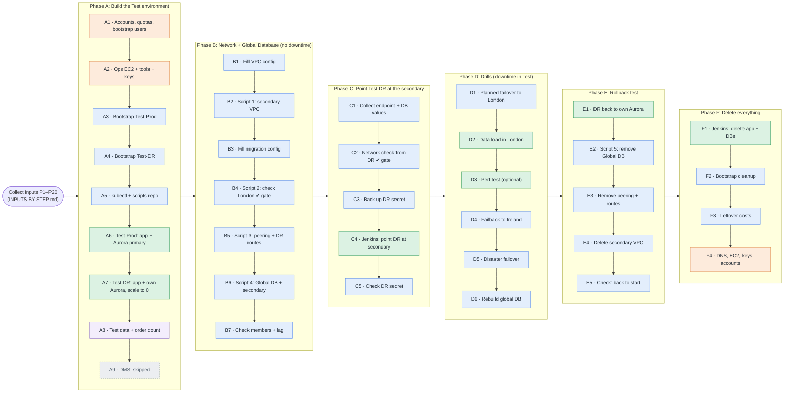

# Test runbook flow: A1 to F4

The whole Test run on one page. Each column is a phase (A to F, left to right); steps run top to bottom.
Colours show where a step runs: **orange** laptop, **blue** EC2 ops instance, **green** Jenkins, **purple** browser.
Click a step in the table below the diagram to open its commands.

Related: [Inputs by step](INPUTS-BY-STEP.md) · [Phase A](PHASE-A-build-test-environment.md) · [Phases B to F](PHASE-B-to-F-global-db-drills-cleanup.md)

Two steps marked **✔ gate** must pass before you go on: **B4** ("All prerequisites are met!") before peering, and **C2** ("CONNECTED") before repointing DR.

## Steps

### Phase A: Build the Test environment

| Step | What | Runs on |
|---|---|---|
| [A1](PHASE-A-build-test-environment.md#a1-create-the-aws-accounts-laptop-about-30-min) | Accounts, quotas, bootstrap users | Laptop |
| [A2](PHASE-A-build-test-environment.md#a2-the-ec2-ops-instance-laptop-then-ec2-about-30-min) | Ops EC2 + tools + keys | Laptop |
| [A3](PHASE-A-build-test-environment.md#a3-bootstrap-the-platform-in-test-prod-ec2-1-to-2-hours) | Bootstrap Test-Prod | EC2 ops instance |
| [A4](PHASE-A-build-test-environment.md#a4-bootstrap-the-platform-in-test-dr-ec2-1-to-2-hours) | Bootstrap Test-DR | EC2 ops instance |
| [A5](PHASE-A-build-test-environment.md#a5-kubectl-access-to-both-clusters-ec2-5-min) | kubectl + scripts repo | EC2 ops instance |
| [A6](PHASE-A-build-test-environment.md#a6-test-prod-app--aurora-jenkins-half-a-day) | Test-Prod: app + Aurora primary | Jenkins |
| [A7](PHASE-A-build-test-environment.md#a7-test-dr-app--its-own-aurora-then-scale-to-0-jenkins--ec2-half-a-day) | Test-DR: app + own Aurora, scale to 0 | Jenkins |
| [A8](PHASE-A-build-test-environment.md#a8-test-data-in-test-prod-browser--ec2-15-min) | Test data + order count | Browser + EC2 |
| [A9](PHASE-A-build-test-environment.md#a9-dms-skip-it) | DMS: skipped | — |

### Phase B: Network + Global Database (no downtime)

| Step | What | Runs on |
|---|---|---|
| [B1](PHASE-B-to-F-global-db-drills-cleanup.md#b1-fill-in-the-vpc-config-ec2) | Fill VPC config | EC2 ops instance |
| [B2](PHASE-B-to-F-global-db-drills-cleanup.md#b2-create-the-secondary-vpc-in-the-test-prod-account-ec2-about-10-min) | Script 1: secondary VPC | EC2 ops instance |
| [B3](PHASE-B-to-F-global-db-drills-cleanup.md#b3-fill-in-the-migration-config-ec2) | Fill migration config | EC2 ops instance |
| [B4](PHASE-B-to-F-global-db-drills-cleanup.md#b4-check-the-london-prerequisites-ec2-2-min) | Script 2: check London ✔ gate | EC2 ops instance |
| [B5](PHASE-B-to-F-global-db-drills-cleanup.md#b5-vpc-peering-test-prod-secondary-vpc-to-test-dr-eks-vpc-ec2-two-terminals-15-min) | Script 3: peering + DR routes | EC2 ops instance |
| [B6](PHASE-B-to-F-global-db-drills-cleanup.md#b6-create-the-global-database-and-the-london-secondary-ec2-30-to-45-min-no-downtime) | Script 4: Global DB + secondary | EC2 ops instance |
| [B7](PHASE-B-to-F-global-db-drills-cleanup.md#b7-check-ec2--browser) | Check members + lag | EC2 ops instance |

### Phase C: Point Test-DR at the secondary

| Step | What | Runs on |
|---|---|---|
| [C1](PHASE-B-to-F-global-db-drills-cleanup.md#c1-collect-the-values-for-the-dr-repoint-ec2) | Collect endpoint + DB values | EC2 ops instance |
| [C2](PHASE-B-to-F-global-db-drills-cleanup.md#c2-check-the-network-path-from-test-dr-ec2-2-min) | Network check from DR ✔ gate | EC2 ops instance |
| [C3](PHASE-B-to-F-global-db-drills-cleanup.md#c3-back-up-the-test-dr-db-secret-ec2) | Back up DR secret | EC2 ops instance |
| [C4](PHASE-B-to-F-global-db-drills-cleanup.md#c4-run-use-existing-database-job-jenkins-test-dr) | Jenkins: point DR at secondary | Jenkins |
| [C5](PHASE-B-to-F-global-db-drills-cleanup.md#c5-check-the-secret-now-points-at-the-secondary-ec2) | Check DR secret | EC2 ops instance |

### Phase D: Drills (downtime in Test)

| Step | What | Runs on |
|---|---|---|
| [D1](PHASE-B-to-F-global-db-drills-cleanup.md#d1-planned-failover-ireland-to-london-about-30-min-no-data-loss) | Planned failover to London | EC2 ops instance |
| [D2](PHASE-B-to-F-global-db-drills-cleanup.md#d2-data-pop-while-failed-over-jenkins-test-only) | Data load in London | Jenkins |
| [D3](PHASE-B-to-F-global-db-drills-cleanup.md#d3-optional-performance-test) | Perf test (optional) | Jenkins |
| [D4](PHASE-B-to-F-global-db-drills-cleanup.md#d4-failback-london-to-ireland-about-30-min) | Failback to Ireland | EC2 ops instance |
| [D5](PHASE-B-to-F-global-db-drills-cleanup.md#d5-disaster-failover-test-only-about-15-min) | Disaster failover | EC2 ops instance |
| [D6](PHASE-B-to-F-global-db-drills-cleanup.md#d6-rebuild-after-the-disaster-30-to-60-min) | Rebuild global DB | EC2 ops instance |

### Phase E: Rollback test

| Step | What | Runs on |
|---|---|---|
| [E1](PHASE-B-to-F-global-db-drills-cleanup.md#e1-point-test-dr-back-at-its-own-aurora-jenkins--ec2) | DR back to own Aurora | Jenkins |
| [E2](PHASE-B-to-F-global-db-drills-cleanup.md#e2-remove-the-global-database-ec2-20-to-30-min) | Script 5: remove Global DB | EC2 ops instance |
| [E3](PHASE-B-to-F-global-db-drills-cleanup.md#e3-remove-the-peering-and-dr-routes-ec2-two-terminals) | Remove peering + routes | EC2 ops instance |
| [E4](PHASE-B-to-F-global-db-drills-cleanup.md#e4-delete-the-secondary-vpc-ec2-about-10-min) | Delete secondary VPC | EC2 ops instance |
| [E5](PHASE-B-to-F-global-db-drills-cleanup.md#e5-check-you-are-back-to-the-start) | Check: back to start | EC2 ops instance |

### Phase F: Delete everything

| Step | What | Runs on |
|---|---|---|
| [F1](PHASE-B-to-F-global-db-drills-cleanup.md#f1-remove-what-the-jenkins-jobs-created-in-each-region-jenkins) | Jenkins: delete app + DBs | Jenkins |
| [F2](PHASE-B-to-F-global-db-drills-cleanup.md#f2-tear-down-the-platform-in-each-account-ec2-about-1-hour-each) | Bootstrap cleanup | EC2 ops instance |
| [F3](PHASE-B-to-F-global-db-drills-cleanup.md#f3-leftovers-that-cost-money-ec2) | Leftover costs | EC2 ops instance |
| [F4](PHASE-B-to-F-global-db-drills-cleanup.md#f4-dns-ops-instance-users-accounts-laptop) | DNS, EC2, keys, accounts | Laptop |
