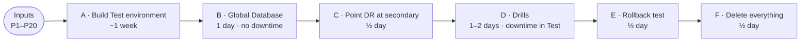

# Aurora Global Database DR: Test plan

** This page states why we are testing, what must be true at the end, and where to find each part of the run.

**Test plan** · [Inputs by step](01-INPUTS-BY-STEP.md) · [Flow](02-FLOW.md) · [Phase A](03-PHASE-A-build-test-environment.md) · [Phases B to F](04-PHASE-B-to-F-global-db-drills-cleanup.md)

---

## Goal

Prove, in a Test environment and before any Production change, that **Aurora Global Database can replace DMS for disaster recovery**. That means proving we can:

- set up the new design without downtime;
- switch the app and database between Ireland and London in both directions, without losing data;
- recover from a simulated loss of Ireland;
- undo the whole change if needed.

The Test run also gives **measured** downtime and recovery times, and a list of surprises, for the Production plan.

## What changes

| | Today (Production) | New design (what this Test proves) |
|---|---|---|
| Production account, Ireland | EKS app + Aurora | EKS app + **Aurora primary** |
| DR copy of the database | Separate Aurora in the **DR account**, filled by **DMS** | **Aurora secondary** in a new London VPC in the **Production account**, filled by **Aurora Global Database** |
| DR account, London | EKS app (standby) + its own Aurora | EKS app (standby) only. It reaches the secondary over **VPC peering** |
| Failover | Repoint the app at the DR Aurora | Global Database switchover or failover, then start the London app |

Global Database needs every cluster in **one account**. That's why the London database copy moves into the Production account, while the London app stays in the DR account.

The Test copies this with two accounts: **Test-Prod** (stands in for Production) and **Test-DR** (stands in for DR).

## Objectives

1. Build Test copies of the Production and DR accounts, each with EKS, the app and Aurora (Phase A).
2. Turn the Test-Prod Aurora into a Global Database with a London secondary in the same account, **without downtime** (Phase B).
3. Connect the Test-DR app, in another account, to that secondary over VPC peering (Phases B and C).
4. Run a **planned switchover** to London and a **failback** to Ireland, both without data loss (Phase D).
5. Run a **disaster failover** and the **rebuild** afterwards (Phase D).
6. **Roll back** to a single-region Aurora and confirm the starting state (Phase E).
7. Record timings and lessons for the Production plan, then delete everything (Phases D and F).

---

## Requirements

### Success criteria

Each requirement is checked at a specific step. The Test passes when all of them pass.

| ID | Requirement | Checked at | Pass when |
|---|---|---|---|
| R1 | Creating the Global Database causes **no downtime** for Test-Prod | B6, B7 | Admin UI and storefront keep working during and after B6 |
| R2 | Replication to London is **fast enough** | B7 | Replication lag normally under 1 second |
| R3 | The Test-DR app, in another account, **reaches the London secondary** | C2 | "CONNECTED" from the Test-DR Jenkins pod |
| R4 | DR is **pointed at the secondary** using the supported job | C4, C5 | The DR secret's host is the secondary endpoint |
| R5 | **Planned switchover** loses no data | D1 | London app works; order count matches the count before the drill |
| R6 | Jenkins jobs **work against London** while it is the writer | D2 | Data load job succeeds; app works afterwards |
| R7 | **Failback** loses no data | D4 | Ireland app works; changes made in London are visible |
| R8 | **Disaster failover** gives a working London app | D5 | London app works after detach and promote |
| R9 | **Rebuild** after a disaster restores the normal setup | D6 | Ireland is writer again, with the order made in London during D5 |
| R10 | The change can be **fully undone** | E1 to E5 | No global cluster, no secondary VPC, DR back on its own Aurora, Test-Prod working |
| R11 | Downtime and recovery times are **measured** | D1 to D6 | Drill results table filled in from `~/drill-log.txt` |
| R12 | Every action is **in the runbooks** | All | No undocumented manual step; anything new is added to the runbooks |
| R13 | **No secrets** are stored in documents or Git | All | Passwords and keys only in a password manager |

### Prerequisites

All of these must be in place before A1. The full list, with who provides each item, is in [Inputs by step, Part 1](01-INPUTS-BY-STEP.md#part-1-collect-before-a1) (items P1 to P20).

| Area | What is needed |
|---|---|
| AWS | Access to the Organizations management account (or two accounts provided to you); vCPU quota in both regions; budget for about 2 weeks |
| Network and DNS | Agreed address ranges (`10.100`, `10.101`, `10.200` `/16`); a parent DNS domain you can add NS records to |
| Code and access | The platform, app and Docker repos with the right to add an SSH key; the migration scripts repo; artifact repository (Nexus) login |
| Platform version | A platform version, or branch, with the "adopt existing database secret" feature (used in C4) |
| People | Cloud governance, network, DNS, platform/Jenkins, DBA, app team and QA, available in the week their steps run |
| Tools | A laptop with the AWS CLI; everything else is installed on the ops EC2 in A2 |

### Out of scope

- The Production change itself, which is planned after this Test passes.
- DMS in Test (step A9 is skipped). Global Database replaces it, and stopping DMS in Production is a single step.
- App code changes.
- Load testing beyond the optional D3.
- Production-grade permissions. Test uses broad IAM rights to keep setup simple; Production needs least privilege.

---

## Plan and timeline

About **2 weeks** of elapsed time.

| Phase | What | Duration | Downtime in Test-Prod | Requirements checked |
|---|---|---|---|---|
| [A](03-PHASE-A-build-test-environment.md) | Accounts, ops EC2, two platform bootstraps, app + Aurora in each region, test data | ~1 week | — | — |
| [B](04-PHASE-B-to-F-global-db-drills-cleanup.md#phase-b-network-and-global-database-ec2-about-1-day-no-downtime) | Secondary VPC, peering, Global Database | 1 day | None | R1, R2 |
| [C](04-PHASE-B-to-F-global-db-drills-cleanup.md#phase-c-point-test-dr-at-the-secondary-ec2--jenkins-half-a-day) | Point Test-DR at the secondary | ½ day | None | R3, R4 |
| [D](04-PHASE-B-to-F-global-db-drills-cleanup.md#phase-d-drills-ec2--browser-1-to-2-days-test-only) | Switchover, failback, disaster, rebuild | 1–2 days | Yes, during drills | R5 to R9, R11 |
| [E](04-PHASE-B-to-F-global-db-drills-cleanup.md#phase-e-rollback-test-ec2--jenkins-half-a-day) | Rollback to single region | ½ day | None | R10 |
| [F](04-PHASE-B-to-F-global-db-drills-cleanup.md#phase-f-delete-everything-ec2--jenkins-half-a-day) | Delete all Test resources | ½ day | — | — |

The step-by-step flow (A1 to F4, with links to each step) is in **[02-FLOW.md](02-FLOW.md)**.

---

## Documents, in reading order

| # | Document | Use it for |
|---|---|---|
| 1 | **Test plan** (this page) | Goal, requirements, scope, timeline |
| 2 | [Inputs by step](01-INPUTS-BY-STEP.md) | What to collect before A1; what each step needs and produces; values register |
| 3 | [Flow](02-FLOW.md) | Diagram of all steps A1 to F4, each linked to its commands |
| 4 | [Phase A](03-PHASE-A-build-test-environment.md) | Commands for A1 to A9 |
| 5 | [Phases B to F](04-PHASE-B-to-F-global-db-drills-cleanup.md) | Commands for B1 to F4, the drill results table, checklists |

Kept on your machine only (git-ignored): the reference run document, the platform settings dump, the Jenkins pipelines, and `test-env/local/`. That last folder holds the vendor-specific versions of these runbooks and the map from each placeholder to its real name.

---

## Sign-off

Fill in at the end of the Test run.

| Requirement | Passed? | Evidence (step, log, screenshot) | Checked by | Date |
|---|---|---|---|---|
| R1 No downtime creating Global DB | | | | |
| R2 Replication lag | | | | |
| R3 DR reaches secondary | | | | |
| R4 DR pointed at secondary | | | | |
| R5 Planned switchover, no data loss | | | | |
| R6 Jenkins jobs work in London | | | | |
| R7 Failback, no data loss | | | | |
| R8 Disaster failover | | | | |
| R9 Rebuild after disaster | | | | |
| R10 Full rollback | | | | |
| R11 Timings recorded | | | | |
| R12 Runbooks complete | | | | |
| R13 No secrets stored | | | | |

**Decision for Production:** ☐ Go  ☐ Go with changes  ☐ No go. Notes:

---

**Next:** [Inputs by step](01-INPUTS-BY-STEP.md)
