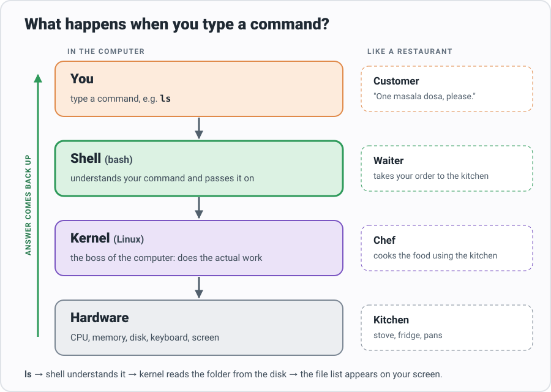
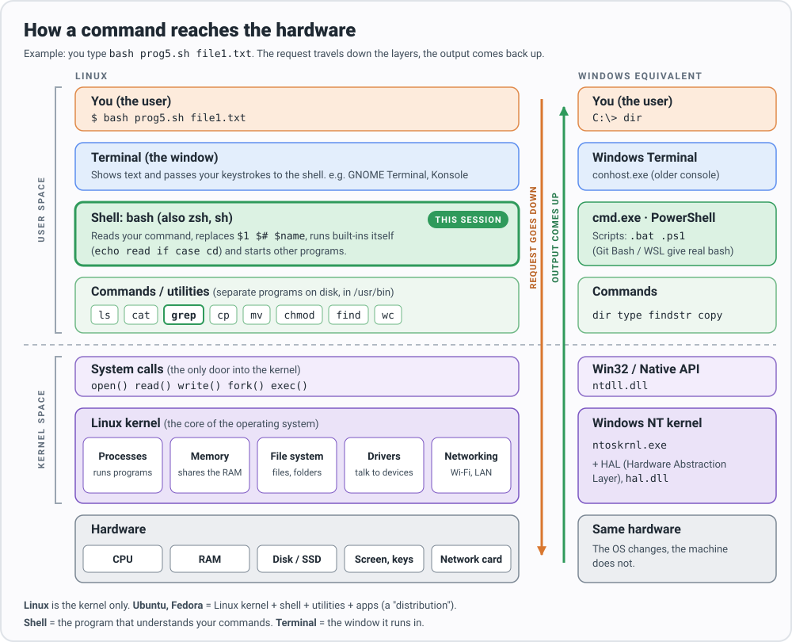

# Shell Scripting Basics: From `echo` to a grep Menu Program

A 90-minute, hands-on session. Every block below can be **copied, pasted
into the terminal, and run**. By the end you will build this lab program
yourself, one step at a time:

> **Program 5.** Write a shell script that takes a file name as a
> command-line argument and, using `grep`:
> 1. selects the lines that have **exactly 2 characters**
> 2. selects the lines that have **more than one blank space**

| Time | Part |
|---|---|
| 0–10 min | [1. What is a shell?](#1-what-is-a-shell) |
| 10–30 min | [2. Building blocks: `echo`, variables, `$`, quotes, `read`, `$1`, `$#`](#2-building-blocks) |
| 30–40 min | [3. Decisions with `if`](#3-decisions-with-if) |
| 40–48 min | [4. Menus with `case`](#4-menus-with-case) |
| 48–60 min | [5. Searching with `grep`](#5-searching-with-grep) |
| 60–63 min | [6. Getting help for any command](#6-getting-help-for-any-command) |
| 63–85 min | [7. Build the program step by step](#7-build-the-program-step-by-step) |
| 85–90 min | [8. Practice](#8-practice) |

---

## 1. What is a shell?



- The **kernel** is the core of Linux. It talks to the hardware.
- The **shell** (`bash`) reads the commands you type and asks the kernel to run them.
- The **terminal** is just the window you type into.

A **shell script** is a text file containing shell commands. Instead of
typing 10 commands one by one, you save them in a file and run the file.

<details>
<summary>Want more detail? The full architecture diagram (system calls, kernel parts, Windows equivalents)</summary>



</details>

### How we create files in this session

Instead of opening an editor, we use `cat` with a "here document". Copy the
**whole block**, paste it into the terminal, and press Enter. Everything
between `<< 'EOF'` and `EOF` gets written into the file.

#### What does `cat > hello.sh << 'EOF'` mean?

Read the line in three pieces:

| Piece | Meaning |
|---|---|
| `cat` | Prints whatever it is given. |
| `> hello.sh` | Don't print to the screen. **Write it into the file `hello.sh`** instead (creates the file, or replaces it if it exists). |
| `<< 'EOF'` | The input comes from **the lines that follow**, up to a line that says only `EOF`. This is called a **here document** ("the input is right here"). |

So in plain English: *"Take the next lines, up to `EOF`, and save them into `hello.sh`."*

You already know `cat > file1.txt` from the lab: you type lines and press
`Ctrl+D` to finish. A here document is the same thing, except the word `EOF`
marks the end instead of `Ctrl+D`. That makes it easy to copy and paste.

Things to know:

- **`EOF` is just a marker word.** It stands for *End Of File*, but any word
  works (`END`, `STOP`…) as long as the start and end match.
- **The closing `EOF` must be alone on its line**, with no spaces before or after it.
- **Why the quotes in `'EOF'`?** They tell the shell to copy the lines
  *exactly as typed*. Without them, `$name`, `$1`, `$#` inside the lines would be
  replaced right now, while creating the file, instead of when the script runs:

  ```bash
  name="Karthik"
  cat << 'EOF'
  Hello $name
  EOF
  cat << EOF
  Hello $name
  EOF
  ```

  ```
  Hello $name
  Hello Karthik
  ```

  For scripts we always want the first behaviour, so we always write `'EOF'`.
- `>` replaces the file. `>>` would **add** to the end of it instead.

Now try it:

```bash
cat > hello.sh << 'EOF'
#!/bin/bash
# My first script. Lines starting with # are comments.
echo "Hello, students!"
echo "Today is:"
date
EOF
```

Run it:

```bash
bash hello.sh
```

Output (your date will differ):

```
Hello, students!
Today is:
Tue Oct 13 10:00:00 IST 2026
```

> You can also use `vi hello.sh` or `nano hello.sh` and type the code yourself.
> The result is the same file.

**What is `#!/bin/bash`?** The first line (called the *shebang*) says which
program should run the script. It matters when you run the script directly:

```bash
chmod +x hello.sh     # give it permission to execute
./hello.sh            # run it directly
```

---

## 2. Building blocks

### 2.1 `echo`: print text

```bash
echo "Hello"
echo "Shell scripting is fun"
```

```
Hello
Shell scripting is fun
```

### 2.2 Variables and `$`

Create a variable with `name=value`. **No spaces around `=`.**
Read the variable back by putting `$` in front of its name.

```bash
name="Karthik"
course="MCA"
echo "My name is $name and I study $course"
```

```
My name is Karthik and I study MCA
```

What happens with spaces?

```bash
name = "Karthik"
```

```
bash: name: command not found
```

Bash thought `name` was a command and `=` and `"Karthik"` were its arguments.

> **Rule:** `name="Karthik"` ✅ `name = "Karthik"` ❌

### 2.3 Single quotes vs double quotes

This one difference causes many bugs.

```bash
name="Karthik"
echo "Hello $name"
echo 'Hello $name'
```

```
Hello Karthik
Hello $name
```

- **Double quotes `" "`**: `$name` is replaced with its value.
- **Single quotes `' '`**: everything is taken literally. `$name` stays as the text `$name`.

### 2.4 `read`: take input from the keyboard

```bash
cat > greet.sh << 'EOF'
#!/bin/bash
echo "What is your name?"
read username
echo "Welcome, $username!"
EOF

bash greet.sh
```

```
What is your name?
Priya            ← you type this and press Enter
Welcome, Priya!
```

### 2.5 Command-line arguments: `$1`, `$2`, `$0`, `$#`

Values you type **after the script name** are passed into the script.

```bash
cat > args.sh << 'EOF'
#!/bin/bash
echo "Script name      : $0"
echo "First argument   : $1"
echo "Second argument  : $2"
echo "Number of args   : $#"
EOF

bash args.sh apple mango
```

```
Script name      : args.sh
First argument   : apple
Second argument  : mango
Number of args   : 2
```

Try it with no arguments:

```bash
bash args.sh
```

```
Script name      : args.sh
First argument   :
Second argument  :
Number of args   : 0
```

| Symbol | Meaning |
|---|---|
| `$0` | name of the script |
| `$1`, `$2`, … | first, second, … argument |
| `$#` | **how many** arguments were given |

### 2.6 `exit`: stop the script

`exit 0` means "finished successfully". `exit 1` (or any non-zero number)
means "stopped because of an error". `$?` shows the exit code of the last
command.

```bash
cat > exit_demo.sh << 'EOF'
#!/bin/bash
echo "Something went wrong, stopping."
exit 1
echo "This line never runs"
EOF

bash exit_demo.sh
echo "Exit code was: $?"
```

```
Something went wrong, stopping.
Exit code was: 1
```

---

## 3. Decisions with `if`

### Syntax

```
if [ condition ]
then
    commands to run when condition is true
else
    commands to run when condition is false
fi
```

- `fi` is `if` written backwards. It closes the `if`.
- **Spaces inside the brackets are required:** `[ $# -lt 1 ]` ✅ `[$# -lt 1]` ❌

### Comparing numbers

| Operator | Meaning | Example |
|---|---|---|
| `-eq` | equal | `[ $a -eq 5 ]` |
| `-ne` | not equal | `[ $a -ne 5 ]` |
| `-lt` | less than | `[ $a -lt 5 ]` |
| `-gt` | greater than | `[ $a -gt 5 ]` |
| `-le` | less than or equal | `[ $a -le 5 ]` |
| `-ge` | greater than or equal | `[ $a -ge 5 ]` |

### Example: check a number

```bash
cat > check_age.sh << 'EOF'
#!/bin/bash
echo "Enter your age:"
read age
if [ $age -ge 18 ]
then
    echo "You can vote."
else
    echo "You cannot vote yet."
fi
EOF

bash check_age.sh
```

```
Enter your age:
20
You can vote.
```

### Example: did the user give an argument? (we need this in the program)

```bash
cat > need_arg.sh << 'EOF'
#!/bin/bash
if [ $# -lt 1 ]
then
    echo "Usage: bash need_arg.sh <filename>"
    exit 1
fi
echo "You gave the file: $1"
EOF

bash need_arg.sh
bash need_arg.sh notes.txt
```

```
Usage: bash need_arg.sh <filename>
You gave the file: notes.txt
```

---

## 4. Menus with `case`

When you need to pick **one action out of several choices**, `case` is
cleaner than many `if`s.

### Syntax

```
case $variable in
    value1)
        commands
        ;;
    value2)
        commands
        ;;
    *)
        commands for anything else
        ;;
esac
```

- `;;` ends each choice.
- `*)` is the "anything else" choice (like `default` in C/Java).
- `esac` is `case` written backwards. It closes the `case`.

### Example

```bash
cat > menu.sh << 'EOF'
#!/bin/bash
echo "1: Show date"
echo "2: Show logged-in user"
echo "Enter your choice:"
read choice
case $choice in
    1)
        date
        ;;
    2)
        whoami
        ;;
    *)
        echo "Invalid choice"
        ;;
esac
EOF

bash menu.sh
```

```
1: Show date
2: Show logged-in user
Enter your choice:
2
karthik
```

---

## 5. Searching with `grep`

`grep` prints the lines of a file that **match a pattern**.

```
grep 'pattern' filename
```

### Create a practice file

```bash
cat > file1.txt << 'EOF'
ab
abc
x
hi
hello world
EOF

cat > file2.txt << 'EOF'
HI I AM KARTHIK.
hello
I love my country.
one space
EOF
```

### Simple search

```bash
grep 'hello' file1.txt
```

```
hello world
```

### Pattern symbols (regular expressions)

| Symbol | Meaning |
|---|---|
| `.` | any **one** character |
| `*` | the thing before it, repeated **0 or more** times |
| `^` | **start** of the line |
| `$` | **end** of the line |

Use **single quotes** around the pattern, so the shell doesn't change `$` or `*`.

Run each line and compare the output:

```bash
grep '^h' file1.txt     # lines that START with h
```

```
hi
hello world
```

```bash
grep 'c$' file1.txt     # lines that END with c
```

```
abc
```

```bash
grep '^..$' file1.txt   # start, any char, any char, end = EXACTLY 2 characters
```

```
ab
hi
```

```bash
grep ' ' file2.txt      # lines with AT LEAST ONE space
```

```
HI I AM KARTHIK.
I love my country.
one space
```

```bash
grep ' .* ' file2.txt   # a space, then anything, then another space = AT LEAST TWO spaces
```

```
HI I AM KARTHIK.
I love my country.
```

`one space` has only one space, so it is not selected.

### Useful options

```bash
grep -n 'h' file1.txt   # -n : show line numbers
grep -c 'h' file1.txt   # -c : count matching lines
grep -i 'HELLO' file1.txt   # -i : ignore upper/lower case
grep -v 'h' file1.txt   # -v : lines that do NOT match
```

```
4:hi
5:hello world
2
hello world
ab
abc
x
```

---

## 6. Getting help for any command

FYI, you don't need to memorise every option.

```bash
man grep          # full manual. Space = next page, q = quit
grep --help       # short summary of options
help if           # help for shell keywords (if, case, read, exit)
type cd           # is it a shell builtin or a program?
```

---

## 7. Build the program step by step

### The problem

> Write a shell script that takes a file name as a command-line argument and, using `grep`:
> 1. selects the lines that have **exactly 2 characters**
> 2. selects the lines that have **more than one blank space**

### Break it down in plain English

1. Make sure the user gave a file name. If not, show how to use the script and stop.
2. Save the file name in a variable.
3. Show a menu (1 or 2) and read the user's choice.
4. Depending on the choice, run the right `grep`.
5. If the choice is anything else, say it is invalid.

### Pseudocode

```
IF number of arguments < 1 THEN
    print "Usage: bash prog5.sh <filename>"
    stop
END IF

file1 ← first argument

print menu: 1 = exactly two characters, 2 = more than one space
read userinput

CASE userinput
    1 → grep lines matching ^..$       in file1
    2 → grep lines matching " .* "     in file1
    anything else → print "Invalid choice"
END CASE
```

Each step below **adds a few lines** to the previous one. Paste the step,
run it, see it work, then move on.

### Step 1: check that a file name was given

Uses: `if`, `$#`, `-lt`, `echo`, `exit` (Parts 2 & 3)

```bash
cat > prog5.sh << 'EOF'
#!/bin/bash
if [ $# -lt 1 ]
then
    echo "Usage: bash prog5.sh <filename>"
    exit 1
fi
echo "OK, got an argument"
EOF

bash prog5.sh
bash prog5.sh file1.txt
```

```
Usage: bash prog5.sh <filename>
OK, got an argument
```

### Step 2: save the file name in a variable

Uses: variables, `$1`, double quotes (Part 2)

```bash
cat > prog5.sh << 'EOF'
#!/bin/bash
if [ $# -lt 1 ]
then
    echo "Usage: bash prog5.sh <filename>"
    exit 1
fi

file1="$1"
echo "File to search: $file1"
EOF

bash prog5.sh file1.txt
```

```
File to search: file1.txt
```

### Step 3: show the menu and read the choice

Uses: `echo`, `read` (Part 2)

```bash
cat > prog5.sh << 'EOF'
#!/bin/bash
if [ $# -lt 1 ]
then
    echo "Usage: bash prog5.sh <filename>"
    exit 1
fi

file1="$1"

echo "Enter the number"
echo "1: Lines with exactly two characters"
echo "2: Lines with more than one blank space"
read userinput
echo "You chose: $userinput"
EOF

bash prog5.sh file1.txt
```

```
Enter the number
1: Lines with exactly two characters
2: Lines with more than one blank space
1
You chose: 1
```

### Step 4: run the right `grep` with `case`

Uses: `case`, `grep`, `^..$`, `' .* '` (Parts 4 & 5)

```bash
cat > prog5.sh << 'EOF'
#!/bin/bash
if [ $# -lt 1 ]
then
    echo "Usage: bash prog5.sh <filename>"
    exit 1
fi

file1="$1"

echo "Enter the number"
echo "1: Lines with exactly two characters"
echo "2: Lines with more than one blank space"
read userinput

case $userinput in
    1)
        grep '^..$' "$file1"
        ;;
    2)
        grep ' .* ' "$file1"
        ;;
esac
EOF

bash prog5.sh file1.txt
```

```
Enter the number
1: Lines with exactly two characters
2: Lines with more than one blank space
1
ab
hi
```

### Step 5: handle a wrong choice → the full program

Add a `*)` branch. This is the **complete program**
(also saved as [`prog5.sh`](./prog5.sh) in this folder).

```bash
cat > prog5.sh << 'EOF'
#!/bin/bash
# Program 5: grep menu
#   1 -> lines with exactly two characters
#   2 -> lines with more than one blank space
# Usage: bash prog5.sh <filename>

# Step 1: make sure a file name was given
if [ $# -lt 1 ]
then
    echo "Usage: bash prog5.sh <filename>"
    exit 1
fi

# Step 2: save the file name
file1="$1"

# Step 3: show the menu and read the choice
echo "Enter the number"
echo "1: Lines with exactly two characters"
echo "2: Lines with more than one blank space"
read userinput

# Step 4 + 5: run the matching grep
case $userinput in
    1)
        grep '^..$' "$file1"
        ;;
    2)
        grep ' .* ' "$file1"
        ;;
    *)
        echo "Invalid choice. Enter 1 or 2."
        ;;
esac
EOF
```

### Run it

```bash
bash prog5.sh file1.txt
```

```
Enter the number
1: Lines with exactly two characters
2: Lines with more than one blank space
1
ab
hi
```

```bash
bash prog5.sh file2.txt
```

```
Enter the number
1: Lines with exactly two characters
2: Lines with more than one blank space
2
HI I AM KARTHIK.
I love my country.
```

```bash
bash prog5.sh
```

```
Usage: bash prog5.sh <filename>
```

### Common mistakes (seen in lab records)

| Wrong | Why it's wrong | Right |
|---|---|---|
| `file1 = '$1'` | Spaces around `=` are not allowed, and single quotes store the text `$1`, not the file name | `file1="$1"` |
| `grep "..$" file` | Matches any line with **2 or more** characters (`abc`, `hello world`…) because it doesn't anchor the start | `grep '^..$' file` |
| `exit 0` after an error message | `0` means success | `exit 1` |
| `if [$# -lt 1]` | Missing spaces inside `[ ]` | `if [ $# -lt 1 ]` |
| Forgetting `;;` or `esac` | Bash reports `syntax error` | End each choice with `;;`, close with `esac` |

---

## 8. Practice

Try these on `file1.txt` / `file2.txt`. Add each as option 3, 4, 5 in your
`case` menu.

1. Lines with **exactly 3 characters**.
2. Lines that **start with a capital letter**. (Hint: `[A-Z]` means "any one capital letter".)
3. **Count** the lines that have more than one blank space. (Hint: `-c`)
4. Bonus: before searching, check that the file exists and print an error
   if it doesn't. (Hint: `if [ ! -f "$file1" ]`)

<details>
<summary>Answers</summary>

```bash
grep '^...$' file1.txt
grep '^[A-Z]' file2.txt
grep -c ' .* ' file2.txt
```

```bash
if [ ! -f "$file1" ]
then
    echo "File $file1 not found"
    exit 1
fi
```

</details>
